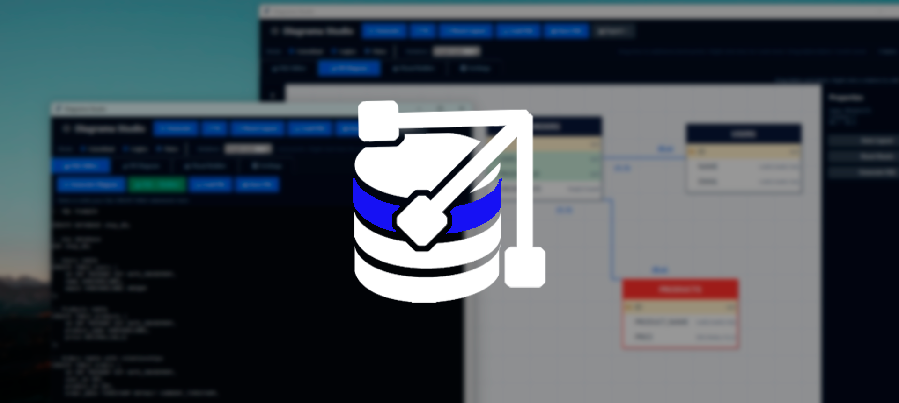
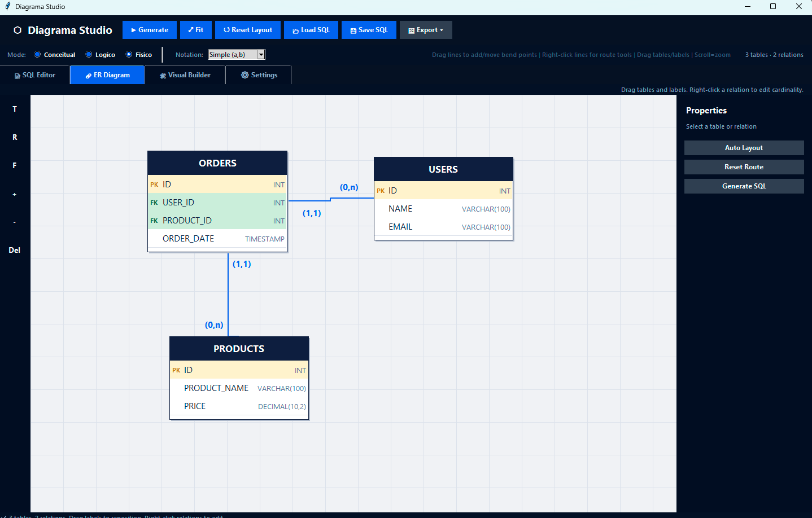

# Diagrama Studio

A tool developed in Python for converting between SQL scripts and data modeling.  
The goal of the project is to simplify the creation, visualization, and documentation of database structures through a practical and intuitive interface.

---

## Requirements

- Windows
- 1GB Ram
- 100 MB storage 

---

## Features

- Conversion of SQL to database diagrams
- Automatic generation of SQL scripts from the model
- Support for table relationships
- Intuitive, productivity-focused interface
- Open-source framework for research and contributions
- Export and visual organization of the data model

---

## Preview

---
## Download

Download the latest version of the installer (BETA):

[⬇ Download Diagrama Studio](https://github.com/MathwlL/DiagramMaker/raw/refs/heads/master/releases/DiagramaMakerInstaller.exe)

---

## Contributing

Contributions, improvements, and suggestions are welcome.  
Feel free to open issues or submit pull requests.

---

## Disclaimer

Diagrama Studio is an independent and experimental project.
